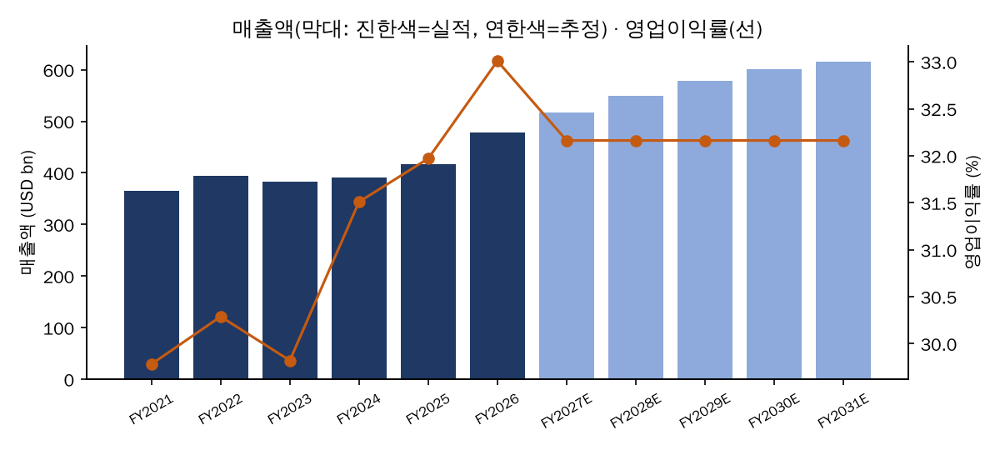
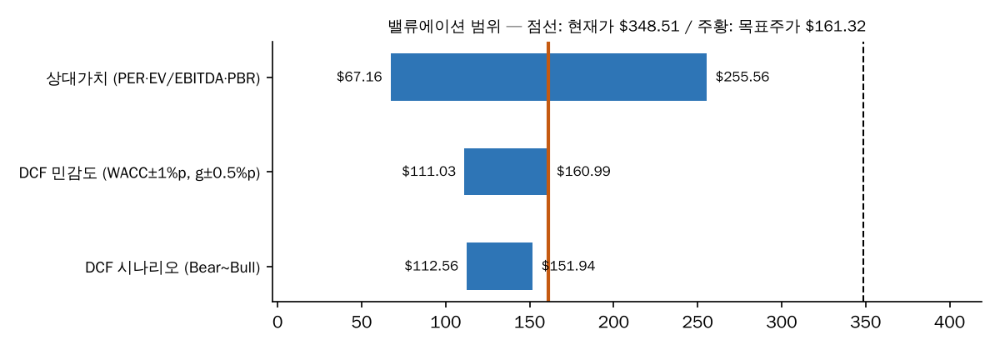

# Apple Inc. (AAPL) 투자분석 보고서

**Apple Inc. — 투자의견 매도(SELL), 목표주가 \$161.32**

작성일 2026-11-11 · AI 미사용 (규칙 기반 모드)

| 투자의견 | 목표주가 | 현재가 | 상승여력 | DCF (Base) | 상대가치 |
|---|---|---|---|---|---|
| **매도(SELL)** | **\$161.32** | \$348.51 | -53.7% | \$131.15 | \$191.50 |

## 1. 투자 요약

- 목표주가 \$161.32는 DCF(\$131.15)와 상대가치(\$191.50)를 가중평균한 값이다.
- 현재가 \$348.51 대비 상승여력은 -53.7%로, 투자의견은 매도(SELL)이다.
- (AI 미사용 모드: 정성적 투자포인트는 생략되었다.)

## 2. 사업 개요

(AI 미사용 모드: 사업 요약 생략)

## 3. 재무 분석

| 항목 (USD bn) | FY2021 | FY2022 | FY2023 | FY2024 | FY2025 | FY2026 |
|---|---:|---:|---:|---:|---:|---:|
| 매출액 | 365.8 | 394.3 | 383.3 | 391.0 | 416.2 | 478.8 |
| 영업이익 | 108.9 | 119.4 | 114.3 | 123.2 | 133.1 | 158.1 |
| 지배주주순이익 | 94.7 | 99.8 | 97.0 | 93.7 | 112.0 | 132.2 |
| 영업활동현금흐름 | 104.0 | 122.2 | 110.5 | 118.3 | 111.5 | 145.1 |
| 설비투자(CAPEX) | 11.1 | 10.7 | 11.0 | 9.4 | 12.7 | 9.0 |
| 자산총계 | 351.0 | 352.8 | 352.6 | 365.0 | 359.2 | 404.5 |
| 자본총계 | 63.1 | 50.7 | 62.1 | 57.0 | 73.7 | 112.1 |
| 매출 성장률 | - | 7.8% | -2.8% | 2.0% | 6.4% | 15.1% |
| 영업이익률 | 29.8% | 30.3% | 29.8% | 31.5% | 32.0% | 33.0% |
| 순이익률 | 25.9% | 25.3% | 25.3% | 24.0% | 26.9% | 27.6% |
| ROE (지배주주) | 150.1% | 197.0% | 156.1% | 164.6% | 151.9% | 117.9% |
| ROIC (세후) | 75.5% | 81.7% | 87.3% | 95.0% | 95.4% | 96.8% |
| 부채비율 (총부채/자본) | 456.4% | 596.2% | 467.3% | 540.9% | 387.2% | 260.9% |
| FCF 마진 (CFO−CAPEX) | 25.4% | 28.3% | 26.0% | 27.8% | 23.7% | 28.4% |

*출처: SEC EDGAR XBRL companyfacts (CIK 0000320193), 10-K 연간값*

- 최근 회계연도 매출은 \$478.8B, 전년 대비 성장률은 +15.1%이다.
- 영업이익률은 33.0% (과거 3개년 평균 32.2%), ROE는 117.9%이다.

## 4. 실적 추정

| Base 시나리오 (USD bn) | FY2027E | FY2028E | FY2029E | FY2030E | FY2031E |
|---|---:|---:|---:|---:|---:|
| 매출 성장률 | 7.8% | 6.5% | 5.2% | 3.8% | 2.5% |
| 매출액 | 516.4 | 549.9 | 578.3 | 600.5 | 615.5 |
| 영업이익률 | 32.2% | 32.2% | 32.2% | 32.2% | 32.2% |
| 영업이익 | 166.1 | 176.9 | 186.0 | 193.1 | 198.0 |
| FCFF | 139.0 | 147.6 | 154.9 | 160.3 | 163.9 |

기타 가정: 세율 18.9%, D&A/매출 2.8%, CAPEX/매출 2.5%, 순운전자본/매출 -6.0%

- **매출 성장률**: 최근 3개년 평균 성장률에서 출발해 5년차에 영구성장률로 선형 수렴
- **영업이익률**: 최근 3개년 평균 영업이익률 유지
- **세율·D&A·CAPEX·NWC**: 최근 3개년 평균 비율 사용 (세율은 비정상 범위면 법정세율)

## 5. 밸류에이션

### 5.1 DCF

| 항목 | 값 |
|---|---:|
| 무위험수익률 | 4.98% |
| 베타 | 1.05 |
| ERP | 5.00% |
| 자기자본비용 | 10.22% |
| 세후 타인자본비용 | 5.12% |
| 자기자본 비중 | 98.4% |
| **WACC** | **10.14%** |
| 영구성장률 | 2.50% |
| 기업가치 | \$1,929.3B |
| 순차입금 | \$23.4B |
| 주주가치 | \$1,905.9B |
| **주당가치 (Base)** | **\$131.15** |
| Bull / Bear | \$151.94 / \$112.56 |
| 잔존가치 비중 | 70.3% |

**민감도 (주당가치)** — 행: WACC, 열: 영구성장률

| WACC \ g | 2.00% | 2.25% | 2.50% | 2.75% | 3.00% |
|---|---:|---:|---:|---:|---:|
| 9.14% | \$142.88 | \$146.92 | \$151.25 | \$155.93 | \$160.99 |
| 9.64% | \$133.36 | \$136.81 | \$140.50 | \$144.46 | \$148.72 |
| 10.14% | \$125.00 | \$127.98 | \$131.15 | \$134.54 | \$138.17 |
| 10.64% | \$117.61 | \$120.20 | \$122.95 | \$125.88 | \$128.99 |
| 11.14% | \$111.03 | \$113.30 | \$115.70 | \$118.25 | \$120.95 |

### 5.2 상대가치

| 비교기업 | 티커 | PER | EV/EBITDA | PBR |
|---|---|---:|---:|---:|
| MICROSOFT CORP | MSFT | 29.6x | 20.7x | 8.9x |
| Alphabet Inc. | GOOGL | 26.6x | 22.9x | 8.5x |
| Dell Technologies Inc. | DELL | 38.5x | 22.2x | - |
| HP INC | HPQ | 10.1x | 7.7x | - |
| **중앙값** | | **28.1x** | **21.5x** | **8.7x** |

| 적용 멀티플 | 적정 주당가치 |
|---|---:|
| PER | \$255.56 |
| EV/EBITDA | \$251.78 |
| PBR | \$67.16 |
| **평균** | **\$191.50** |

### 5.3 종합

목표주가 = DCF 50% + 상대가치 50% 가중평균 → **\$161.32** (상승여력 -53.7%, 투자의견 매도(SELL))

- WACC 10.1% (자기자본비용 10.2%, 베타 1.05), 영구성장률 2.5% 기준 DCF 주당가치는 \$131.15이며, 잔존가치 비중은 70.3%이다.
- 피어 중앙값 PER 28.1배, EV/EBITDA 21.5배, PBR 8.7배 적용 시 상대가치 주당가치는 \$191.50이다.

## 6. 투자 리스크

- (AI 미사용 모드: 리스크 분석은 생략되었다.)

## 부록 A. 검증 결과

- **Excel 교차검증**: PASS — Python 엔진과 Excel 수식(LibreOffice 재계산)이 43개 항목 중 43개 일치
- **데이터 검증**: PASS 20 / WARN 0 / FAIL 0
- **수치 감사** (AI 서술 내 자리표시자 외 숫자): 0건

## 부록 B. 데이터 출처·방법론

- 재무: SEC EDGAR XBRL companyfacts (CIK 0000320193), 10-K 연간값
- 공시 원문: [Form 10-K (기준일 2026-09-26)](https://www.sec.gov/Archives/edgar/data/320193/000032019326000026/aapl-20260926.htm)
- 주가·베타: Yahoo Finance (^GSPC 대비 주간 로그수익률 104개 회귀, 원시 β=1.072, Blume 조정(0.67·β+0.33))
- 무위험수익률: 미 10년물 국채수익률(^TNX) 2026-11-10
- 역할 분담: 수집·표준화·비율·추정·DCF·상대가치·투자의견은 코드와 Excel 수식이 계산하고, AI는 공시 해석·가정 제안(가드레일로 검증)·서술만 담당합니다. 보고서의 모든 수치는 코드 계산값을 자리표시자로 삽입한 것입니다.

---
*본 보고서는 자동 생성된 분석 초안으로 투자 권유가 아닙니다. 공시 데이터의 표준화 과정에서 오차가 있을 수 있으니 Excel 모델의 원천 데이터와 가정을 검토한 뒤 활용하세요.*